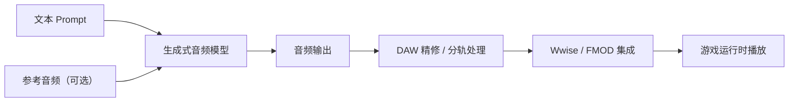

# 当下 AIGC 在游戏音频设计中的应用 · 调研报告

> **主题**：AIGC（AI Generated Content）在游戏音频设计中的落地现状
> **调研方式**：桌面调研（行业协会报告、厂商技术分享、行业媒体与技术社区公开资料）
> **调研截止**：2025 年底公开信息
> **行文主线**：音频三支柱（Voice / Music / SFX）× 生成范式（Text-to-Audio / Text-to-Video 等）

---

## 目录

1. 摘要
2. 调研范围与方法
3. 主线一：从音频三支柱看 AIGC 应用
   - 3.1 Voice（语音 / 配音）
   - 3.2 Music（音乐 / 配乐）
   - 3.3 SFX（音效）
4. 主线二：从生成范式看 AIGC 应用
   - 4.1 Text-to-Audio
   - 4.2 Text-to-Video 中的音频生成
   - 4.3 其他范式
5. 行业现状与代表案例
6. 工具矩阵速览
7. 挑战与争议
8. 趋势展望
9. 结论
10. 参考文献
11. 附录 A：图片与视频辅助材料（GitHub 用法）
12. 附录 B：GitHub Markdown 语法注意点

---

## 1. 摘要

- AIGC 已从“新奇 demo”进入游戏音频的生产管线，覆盖 **语音（Voice）、音乐（Music）、音效（SFX）** 三大支柱。
- 交互范式上，**Text-to-Audio** 是当前最主流、工具化最成熟的方式；**Text-to-Video** 模型开始原生输出音轨，是值得重点关注的新兴方向。
- 国内行业层面，游戏工委在 2025 中国游戏产业年会上发布的《游戏企业 AI 技术应用课题报告》显示，AI 已成为 2025 年全球游戏行业最大热点之一，调研覆盖 22 家国内大厂 [1]。
- 价值集中在两点：**降本增效**（草稿、批量资产、本地化配音）与 **体验升级**（实时 NPC 语音、动态/自适应音乐）。
- 主要风险：**版权与授权、角色音色一致性、实时延迟、配音演员工会的利益博弈**。

---

## 2. 调研范围与方法

| 资料类型 | 代表来源 |
| --- | --- |
| 行业协会报告 | 游戏工委《游戏企业 AI 技术应用课题报告》（2025）[1] |
| 厂商技术访谈 | 趣加音乐总监张志伟谈 AI 与游戏音频 [2] |
| 大厂技术分享 | 网易伏羲 3D AIGC 产业实践 [3] |
| 行业媒体 | AI 赋能游戏音效设计的趋势分析 [4] |
| 技术社区 | AIGC 音频生成在游戏开发中的落地实践 [5] |
| 产品公开资料 | ElevenLabs / NVIDIA / Stability AI / OpenAI / Google 等官方文档（未标注编号者） |

---

## 3. 主线一：从音频三支柱看 AIGC 应用

### 3.1 Voice（语音 / 配音）

**语音是 AIGC 在游戏音频中商业化最成熟的方向**，典型场景如下。

**TTS 与声音克隆**

- ElevenLabs：多语言 TTS、即时声音克隆（Instant Voice Cloning），已成为独立游戏与原型阶段 NPC 配音、多语言本地化的常用工具。
- Respeecher：面向专业制作的声音转换工具。知名案例：《赛博朋克 2077：往日之影》经已故配音演员家属授权，用 AI 复现其音色（Viktor 一角）。
- 开源社区：RVC、So-VITS-SVC 等语音转换模型流行于低成本试配与二次创作，但商用需严格审核训练数据与授权。

**NPC 实时对话与情感语音**

- NVIDIA ACE（Avatar Cloud Engine）：提供可在本地运行的 ASR、小型语言模型（SLM）、TTS 以及 Audio2Face 口型驱动，用于低延迟的实时 NPC 对话。
- Inworld AI：专注游戏 NPC 的“大脑 + 语音”引擎，与 NVIDIA 合作在 GDC 2024 演示了实时 NPC 对话项目《Covert Protocol》。
- 国内厂商同样把智能 NPC 列为重点：趣加访谈中明确提到虚拟人、音频模仿、智能 NPC 等应用场景 [2]；网易伏羲多年 AIGC 实践中亦包含智能 NPC 与语音方向 [3]。

**多语言本地化**

- 用 AI 复刻角色原始音色后直接生成小语种版本，显著降低多语言配音成本——这正是行业所说的“音频模仿”应用 [2]。

**关注点**：情感表现力上限、同一角色多次生成的音色漂移，以及 SAG-AFTRA 2024 年发起的游戏行业罢工（AI 使用与补偿是核心议题之一）。

### 3.2 Music（音乐 / 配乐）

**文本生成 BGM 是当下最热门的探索方向，但版权博弈也最激烈。**

| 路线 | 代表工具 | 特点 |
| --- | --- | --- |
| 完整歌曲生成 | Suno、Udio | 人声 + 伴奏一体，适合 demo 与创意探索；训练数据引发诉讼，商用授权需谨慎 |
| 面向制作人 | Stable Audio 2.0 | 音乐/音效生成、Audio-to-Audio 风格迁移，约 3 分钟长度，主推可商用授权路线 |
| 科研开源 | Meta AudioCraft（MusicGen/AudioGen）、Google MusicLM/MusicFX | 开源模型或研究产品，适合自研管线 |
| 可控生成 | Adobe Project Music GenAI Control | 强调“生成后再编辑”的可控工作流 |
| 免版税商用 | ElevenLabs Eleven Music（2025） | 面向游戏/影视的免版税配乐生成 |

**与中间件的结合**：AI 音乐输出分轨（stems）后导入 Wwise / FMOD，按游戏状态做参数化切换，形成“生成式内容 + 交互逻辑”的混合工作流。当前工程难点在于 AI 生成的音乐**循环点（loop point）不自然、分轨分离质量不稳**。

**版权状态**：Suno / Udio 因训练数据问题被美国唱片业协会（RIAA）于 2024 年 6 月起诉；商用项目普遍转向有明确授权的工具（如 Stable Audio、Eleven Music）。

### 3.3 SFX（音效）

- **Text-to-SFX**：以文字描述生成音效（如 ElevenLabs Sound Effects、Stable Audio），替代部分采样库检索与拟音（Foley）工作 [4]。
- **典型用途**：
  - 开发期原型音效（白盒阶段即可试听氛围）；
  - 大量重复性 UI 音效的批量生成；
  - 环境声、天气声等“氛围类”素材的高效产出。
- **局限**：复杂合成音效（如武器、魔法）的物理真实感与“味道”不足，仍需专业声音设计师精修，行业分析亦认为当前阶段是“智能生成辅助，而非替代” [4]。
- **融合趋势**：生成式素材与**程序化音频（Procedural Audio）**结合，在引擎内做参数化实时合成，被视为下一代音效设计的重要方向 [4]。

---

## 4. 主线二：从生成范式看 AIGC 应用

### 4.1 Text-to-Audio

当前最主流的生成范式：**文本（可附加参考音频）→ 生成模型 → 目标音频**。

**技术路线概览**：

- 潜在扩散模型：Stable Audio 系列（44.1kHz 输出）。
- 自回归 token 模型：Meta AudioGen / MusicGen。
- 频谱图扩散：Riffusion 等早期路线。

**典型工作流（Mermaid 图）**：



在游戏音频环节中的定位：**原型 demo、临时音轨（temp track）、批量资产、本地化配音** [4][5]。

### 4.2 Text-to-Video 中的音频生成

视频生成模型正在从“无声”走向“音画同源”，对游戏行业的前期预览（previsualization）与概念片制作流程产生直接影响：

- Google Veo 3（2025 年 5 月发布）宣称支持原生音轨生成；
- OpenAI Sora 2（2025 年 9 月发布）支持音画同步生成音频；
- 腾讯 GameGen-O 等模型探索开放世界游戏画面的视频级生成，为“文本直接生成可玩片段（含声音）”做技术储备。

**对游戏音频的意义**：

- 过场动画、玩法原型的概念预视可以一次性产出“画面 + 环境声 + BGM”；
- 音频团队可提前拿到“有声预视”来对齐风格方向。

**当前局限**：音频与画面的时空对齐不稳定，且生成延迟远高于游戏实时要求，暂无法直接服务运行时。

### 4.3 其他范式

| 范式 | 说明 | 游戏音频场景 |
| --- | --- | --- |
| Audio-to-Audio | 风格迁移、音色转换 | 音效风格统一、配音音色复刻 |
| Speech-to-Speech | 保留语气韵律的语音转换 | 多语言配音、角色试配 |
| 实时生成 | 本地小模型推理降延迟 | NVIDIA ACE 式实时 NPC 对话 |
| Audio-driven Animation | Audio2Face 类口型/表情驱动 | NPC 面部与语音同步 |

---

## 5. 行业现状与代表案例

- **游戏工委报告（2025）**：在 2025 中国游戏产业年会 AI 分论坛发布，调研 22 家国内大厂，明确 AI 是 2025 年全球游戏行业最大热点之一 [1]。
- **趣加（FunPlus）**：音乐总监张志伟详解 AI 对游戏音频领域的改变与帮助，指出虚拟人、音频模仿、智能 NPC 成为厂商关注焦点，并说明 AI 用于提升研发效能 [2]。
- **网易伏羲**：在产业年会分享 3D AIGC 多年产业实践 [3]；其智能 NPC 与语音技术方向与音频管线形成协同。
- **行业媒体观察**：音效设计正从“智能生成”走向“沉浸式体验”，AI 深度嵌入音频工作流 [4]。
- **技术社区**：大量开发者实践表明，AIGC 音频已进入游戏开发的创新应用阶段，从资产生产到交互体验均有落地 [5]。

> 说明：未标注引用编号的工具与案例（如 NVIDIA ACE、ElevenLabs、Respeecher、Suno 等）来自相关产品公开文档与行业公开报道，正文已逐一注明，可结合第 10 节参考外链复核。

---

## 6. 工具矩阵速览

| 分类 | 代表工具 | 厂商/社区 | 核心能力 | 游戏音频典型场景 |
| --- | --- | --- | --- | --- |
| 语音 | ElevenLabs | ElevenLabs | TTS / 声音克隆 / SFX / Music | NPC 配音、本地化、音效生成 |
| 语音 | Respeecher | Respeecher | 专业级声音转换 | 复现历史角色音色、跨语言保留音色 |
| 语音 | NVIDIA ACE | NVIDIA | 本地 ASR / SLM / TTS / Audio2Face | 实时 NPC 对话与口型驱动 |
| 语音 | RVC / So-VITS-SVC | 开源社区 | 语音转换 | 低成本试配、二次创作（注意授权） |
| 音乐 | Suno / Udio | Suno / Udio | 文本生成完整歌曲 | Demo、UGC、创意探索（注意商用条款） |
| 音乐 | Stable Audio 2.0 | Stability AI | 音乐/音效生成、Audio-to-Audio | 可商用 BGM 与音效 |
| 音乐 | AudioCraft | Meta | 开源生成模型 | 自研管线、学术研究 |
| 音效 | ElevenLabs Sound Effects | ElevenLabs | Text-to-SFX | UI / 环境 / 武器音效草稿 |
| 视频+音频 | Sora 2 / Veo 3 | OpenAI / Google | Text-to-Video 原生音轨 | 概念片、过场预视 |
| 中间件 | Wwise / FMOD | Audiokinetic / Firelight | 交互音频引擎 | 生成资产的参数化集成与运行时控制 |

> 选型提醒：不同工具的商业授权条款差异极大，商用前请核对最新许可协议。

---

## 7. 挑战与争议

**技术与工程**

- **音色一致性**：同一角色多次生成的音色漂移，需要 voice lock、种子控制等手段。
- **实时性**：云端 TTS/生成延迟高，实时 NPC 对话必须依赖本地小模型推理。
- **循环与分轨**：AI 音乐 loop 点不自然、stems 分离质量直接影响 Wwise/FMOD 集成效果。
- **可控性**：文本 prompt 的控制粒度不足，复杂音效的物理真实感欠佳 [4]。

**法律与伦理**

- **训练数据版权**：Suno/Udio 被 RIAA 起诉即为标志性事件。
- **演员工会博弈**：SAG-AFTRA 2024 年游戏行业罢工的核心诉求之一即 AI 使用的知情同意与补偿。
- **声音权与形象权**：克隆真人声音需获得授权（如《赛博朋克 2077》案例中的家属授权）。
- **合规要求**：中国《生成式人工智能服务管理暂行办法》及《互联网信息服务深度合成管理规定》对训练数据合规与生成内容标识提出要求。
- **商用授权混乱**：各工具商用条款不统一，给团队带来法务成本。

---

## 8. 趋势展望

1. **从云生成到本地实时生成**：NPC 语音与交互音频走向本地推理、低延迟实时化。
2. **生成式 + 程序化融合**：引擎内参数化实时合成成为下一代声音设计范式 [4]。
3. **个性化动态配乐**：依据玩家行为、情绪与剧情状态实时调整甚至生成 BGM。
4. **音画同源**：Text-to-Video 原生音频成熟后，重塑概念片、过场预视工作流。
5. **授权与标准化**：AI 声音库、声音授权交易、工会协议与行业标准逐步成形。
6. **工具链下移**：面向 Wwise / FMOD 的官方与第三方 AI 插件增多，降低集成门槛。

---

## 9. 结论

AIGC 在游戏音频中的角色正在从“新奇 demo”转变为“管线基础设施”：

- **Voice**：商业化最成熟，本地化与 NPC 实时对话是两大增长极；
- **Music**：效率收益明显，但版权博弈最激烈，选型必须前置法务审查；
- **SFX**：重复性资产提效最直接，复杂设计仍需人工主导 [4]。

范式上，**Text-to-Audio 是当下主力**，**Text-to-Video 原生音轨是重要新兴变量**。务实落地路径建议采用“**AI 草稿 + 人工精修 + 中间件集成**”的三段式 [1][2][4][5]。

---

## 10. 参考文献

1. 游戏工委《游戏企业 AI 技术应用课题报告》（2025），GameLook 报道：<http://www.gamelook.com.cn/2025/12/584581/>
2. 趣加音乐总监张志伟：详解 AI 技术在游戏音频领域的改变与帮助，游戏日报：<https://news.yxrb.net/2023/0528/1932.html>
3. 网易伏羲：3D AIGC 的 8 年实践分享，小米游戏中心：<https://game.xiaomi.com/viewpoint/1393220466_1766644665311_100>
4. AI 赋能游戏音效设计：从智能生成到沉浸式体验，K7DJ：<https://www.k7dj.com/d/11887>
5. AIGC 音频生成在游戏开发中的创新应用，爱代码爱编程：<https://icode.best/i/529389404575644>
6. 其他公开产品资料：ElevenLabs、NVIDIA ACE、Stability AI、OpenAI、Google DeepMind 官方文档与公告（正文已注明，此处不逐一列链接）

---

## 11. 附录 A：图片与视频辅助材料（GitHub 用法）

**图片**（GitHub 支持）：将图片放入仓库 `assets/` 目录，使用相对路径引用：

```markdown

```

**视频**：GitHub Markdown **不支持** `<video>` 标签内嵌播放（会被过滤）。推荐三种方式：

1. 上传视频后用链接引用，点击跳转 GitHub 文件页预览播放：

   ```markdown
   [▶ 观看 Text-to-SFX 演示视频](./assets/demo.mp4)
   ```

2. 制作 GIF 预览（GitHub 会自动播放 GIF）：

   ```markdown
   
   ```

3. 外链到 Bilibili / YouTube 等平台。

**建议素材清单（待补充占位）**：

- [ ] `assets/workflow.png` — AIGC 音频工作流图（对应 4.1 节 Mermaid 图的成图）
- [ ] `assets/demo.mp4` — Text-to-SFX 工具演示
- [ ] `assets/npc-voice.mp4` — NVIDIA ACE 实时 NPC 对话演示（外链亦可）

---

## 12. 附录 B：GitHub Markdown 语法注意点

- 标题用 `#` 分级，列表用 `-`，任务列表用 `- [ ]` / `- [x]`（GFM 支持）。
- 表格：表头下一行必须是 `| --- | --- |` 分隔行，列数需一致。
- **GitHub 不支持脚注**（`[^1]` 语法），参考文献请使用普通列表 + 链接（本文档已按此处理）。
- GitHub 支持 **Mermaid** 图表（` ```mermaid ` 代码块），本文档 4.1 节已使用。
- 图片一律使用**相对路径**（`./assets/xxx.png`），不要用本地绝对路径（`C:\...` 或 `/Users/...`）。
- 大体积视频/音频素材建议放 Release 或 Git LFS，避免仓库过大。
- 建议文件名：`README.md`（仓库首页自动渲染）或 `docs/game-audio-aigc-survey.md`。
- 引用块 `>`、行内代码 `` `code` ``、删除线 `~~text~~`、emoji `:rocket:` 均为 GFM 支持语法。
- 上传后若目录锚点链接失效，删除目录链接、仅保留纯文本列表即可（GitHub 会自动为中文标题生成锚点，但特殊符号会影响锚点）。
